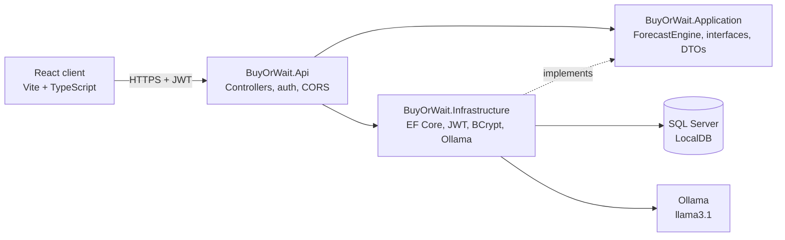

# Buy or Wait

**Should I buy this now, or wait?** Buy or Wait projects your bank balance 90 days ahead, checks it against a safety floor you set, and recommends how to pay: in full, part now, in installments, or not yet. A local LLM then explains the decision in plain English.

The decision is made by deterministic C# code. The AI only writes the explanation, so it can't change the verdict.

---

## Features

- **90-day cash-flow forecast** built from your current balance and your regular monthly income and expenses
- **Four recommendations:** Buy it now · Pay part now · Split into installments · Wait
- **Interactive balance chart** showing the projected line against your safety floor
- **"How we got this answer"** trace that lists every step of the calculation
- **AI explanation** generated locally with Ollama (llama3.1). There's a fallback message if the model is offline.
- **JWT authentication** with BCrypt password hashing; each user only sees their own data
- **Finances page** to manage your balance, safety floor, and monthly income and expenses

| Finances | Buy or Wait |
|---|---|
|  |  |

---

## How the recommendation works

The forecast engine tries each payment plan in order and picks the **first** one that keeps your lowest projected balance at or above your safety floor:

1. **Pay in full** today
2. **Pay part now**: half today, half later
3. **Installments**: three equal payments
4. **Wait**: none of the plans are safe

The engine returns the verdict, the lowest projected balance, the day-by-day timeline for the chart, and a step-by-step trace. That result, and only that, is sent to the LLM to phrase as an explanation.

---

## Architecture



**Clean architecture.** `Application` holds the business logic and interfaces (`ITokenService`, `IPasswordHasher`, `IRecommendationNarrator`, `ITracer`) and depends on nothing external. `Infrastructure` implements those interfaces. `Api` wires everything together with dependency injection. This is why the forecast engine is unit-tested without a database or an LLM.

```
buy-or-wait/
├── server/
│   ├── BuyOrWait.Api/             # Controllers, Program.cs (DI, JWT, CORS, Swagger)
│   ├── BuyOrWait.Application/     # ForecastEngine, interfaces, DTOs
│   ├── BuyOrWait.Infrastructure/  # EF Core DbContext + migrations, JWT, BCrypt, Ollama narrator
│   └── BuyOrWait.Tests/           # xUnit tests for the forecast engine
└── client/                        # React + TypeScript + Vite
    └── src/
        ├── pages/                 # Login, Finances, BuyOrWait (lazy-loaded)
        ├── components/            # Forms, result card, chart, layout, error boundary
        ├── auth/                  # AuthContext (token state + useAuth hook)
        └── api.ts                 # fetch wrapper: base URL, JWT header, 401 handling
```

---

## Tech stack

| Layer | Technology |
|---|---|
| Backend | ASP.NET Core (.NET 10), C#, Entity Framework Core, SQL Server LocalDB |
| Auth | JWT bearer tokens, BCrypt password hashing |
| AI | Semantic Kernel (OpenAI connector) → Ollama running llama3.1 locally |
| Frontend | React, TypeScript, Vite, React Router, TanStack Query, Tailwind CSS, Recharts |
| Testing | xUnit (backend), Vitest + React Testing Library (frontend) |

---

## Run it locally

### Prerequisites

- [.NET 10 SDK](https://dotnet.microsoft.com/download)
- [Node.js](https://nodejs.org/) 20 or later
- SQL Server LocalDB (installed with Visual Studio)
- [Ollama](https://ollama.com/) with the model pulled: `ollama pull llama3.1`

### 1. Backend

```bash
git clone https://github.com/asaikavya/buy-or-wait.git
cd buy-or-wait/server/BuyOrWait.Api

# Set a JWT signing key (at least 32 characters). It stays outside the repo.
dotnet user-secrets set "Jwt:Key" "<a-long-random-string>"

# Create the database
dotnet ef database update --project ../BuyOrWait.Infrastructure

dotnet run
```

The API runs at `https://localhost:7101`, with Swagger at `https://localhost:7101/swagger`.

The API refuses to start if `Jwt:Key` is missing or shorter than 32 characters. The error message tells you the exact command to fix it.

### 2. Frontend

```bash
cd buy-or-wait/client
cp .env.example .env      # points the client at https://localhost:7101
npm install
npm run dev
```

Open `http://localhost:5173`. Create an account using the Auth endpoints in Swagger, then log in.

### 3. Ollama

Make sure Ollama is running (`ollama serve`). If it isn't, the app still works and shows a plain fallback explanation instead of the AI one.

---

## Tests

```bash
# Backend
cd server
dotnet test

# Frontend
cd client
npx vitest run
```

Frontend tests cover currency formatting, the correct verdict title for each of the four recommendations, and the error fallback's retry button.

---

## Key decisions

| Decision | Why |
|---|---|
| **Deterministic engine decides, the LLM only explains** | Financial advice must be reproducible and testable. The prompt is grounded in the engine's numbers and told not to invent facts, so the AI can't change the verdict. |
| **Budget-plan model for transactions** | Income and expenses are *monthly cash flow* used for forecasting. They don't change the current balance, which the user sets directly. This keeps the forecast simple and predictable. |
| **TanStack Query for server data** | Caching, request de-duplication, retries, and cache invalidation after edits, without hand-written loading and refresh code. The settings query is shared between pages from one cache. |
| **Context only for auth** | The token is the only truly global client state, so a small `AuthContext` plus a `useAuth` hook is enough. No Redux. |
| **Lazy-loaded pages** | Pages behind login are split into their own chunks, so the login page doesn't download Recharts. |
| **Error boundary around page content** | A crash in one page shows a friendly fallback while the header and navigation keep working. |
| **Local LLM via Ollama** | Free and private, and no API key needs to be managed. The narrator sits behind `IRecommendationNarrator`, so switching to Azure OpenAI is a configuration and DI change. |
| **Secrets in User Secrets, with a startup check** | No keys in source control. The app fails fast with a clear message if the key is missing. |

---

## Known limitations and next steps

- **Monthly income is spread evenly across each day.** Real paychecks arrive in lumps; v2 would model pay dates.
- **All transactions are treated as monthly**, including one-off ones. v2 would apply one-off transactions once, on their date.
- **"Wait" doesn't say until when.** v2 would find the first day the purchase becomes safe.
- **The last analysis clears when you leave the page.** It could persist through the TanStack mutation cache (`useMutationState`) or by lifting state up.
- **Not deployed.** The next step is Azure App Service plus Azure SQL, with Key Vault for secrets and a GitHub Actions pipeline.
